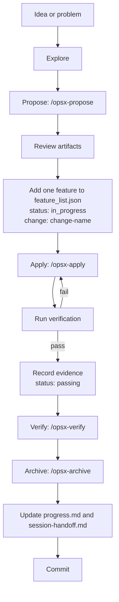

# OpenSpec + OpenCode Harness Template

> A spec-driven, five-subsystem template for reliable coding-agent work.

[](LICENSE)
[](https://github.com/J0sePs/openspec-opencode-template/generate)
[](https://github.com/Fission-AI/OpenSpec)
[](https://opencode.ai)
[](#the-five-subsystems)
[](https://github.com/J0sePs/openspec-opencode-template/actions/workflows/verify.yml)

Most agent failures are not model failures. They are harness failures: the
agent starts cold, forgets what changed, works on three things at once, and
declares victory before the tests pass.

This template gives a coding agent a small, durable environment:

- **OpenSpec** turns an idea into a reviewed change with specs, design, and
  tasks.
- **Five harness subsystems** keep execution scoped, verified, and restartable.
- **OpenCode** provides the `/opsx-*` commands that connect the two.

It contains only the template — no application code, no framework, no
language-specific assumptions. Add your project on top.

## Why this exists

A strong model in a weak environment still produces unreliable work. The fix is
not a longer prompt. It is a repository that tells the agent what to read, what
to work on, how to prove it, and how to leave a clean state for the next
session.

The harness model is adapted from
[Learn Harness Engineering](https://github.com/walkinglabs/learn-harness-engineering).
The planning workflow is [OpenSpec](https://github.com/Fission-AI/OpenSpec).
The agent integration is [OpenCode](https://opencode.ai).

## The five subsystems

| Subsystem | Artifacts | Job |
| --- | --- | --- |
| **Instructions** | `AGENTS.md`, `docs/*.md`, `openspec/config.yaml` | Route the agent: startup order, invariants, definition of done, and where to read more |
| **State** | `feature_list.json`, `progress.md` | Persist what is done, what is active, and what comes next |
| **Verification** | `init.sh`, `scripts/verify.sh`, `scripts/validate-harness.mjs` | Make "done" mean the checks actually ran |
| **Scope** | `feature_list.json`, `openspec/changes/<change>/tasks.md` | Keep one feature and one change in flight |
| **Session lifecycle** | `session-handoff.md`, startup and end-of-session routines | Leave a restart path the next session can follow |

Read [docs/harness.md](docs/harness.md) for the full model and the failure each
subsystem prevents.

## What you get

- A root instruction file that routes, not lectures.
- A machine-readable feature list with evidence.
- A one-command verification gate used locally and in CI.
- A session handoff that survives context loss.
- An OpenSpec configuration with project-specific artifact rules.
- Twelve `/opsx-*` workflow commands and matching OpenSpec skills.
- A complete reference change in `examples/sample-change/`.
- A zero-dependency harness validator that scores all five subsystems.

## Repository layout

```text
.
├── AGENTS.md                    # Root instructions: startup, scope, done, handoff
├── CLAUDE.md                    # Pointer for Claude Code
├── README.md
├── LICENSE
├── init.sh                      # Standard startup: install + verify
├── feature_list.json            # Scope and acceptance state
├── progress.md                  # Session log and verified state
├── session-handoff.md           # Compact handoff for the next session
├── docs/
│   ├── harness.md               # The five subsystems and their artifacts
│   ├── workflow.md              # OpenSpec + harness workflow, end to end
│   └── customize.md             # Adoption checklist and troubleshooting
├── scripts/
│   ├── verify.sh                # Verification gate
│   └── validate-harness.mjs     # Zero-dependency harness validator
├── openspec/
│   ├── config.yaml              # Project constraints for OpenSpec artifacts
│   ├── specs/                   # Durable capabilities (after archive)
│   └── changes/                 # In-flight changes + archive/
├── .opencode/
│   ├── commands/                # /opsx-* workflow commands
│   └── skills/                  # OpenSpec skills
├── examples/
│   └── sample-change/           # Reference change (not active)
└── .github/
    └── workflows/verify.yml     # CI verification gate
```

## Quick start

### Use this template

Click **Use this template** on GitHub, or:

```bash
git clone https://github.com/J0sePs/openspec-opencode-template.git my-project
cd my-project
rm -rf .git
git init -b main
```

### Install the prerequisites

- **Node.js 20+**
- **OpenSpec CLI 1.x**

```bash
npm install --global @fission-ai/openspec
```

- **OpenCode**, or any coding agent that reads `AGENTS.md`
- **Git**

### Run the harness

```bash
./init.sh
```

Expected output ends with:

```text
Result: 5/5 subsystems passed, ... checks passed.
VERIFICATION PASSED
```

### Start your first change

Open the repository in OpenCode and run:

```text
/opsx-propose add-first-feature
```

Review the generated proposal, specs, design, and tasks. Then register the
matching feature in `feature_list.json` with status `in_progress` and the change
name, and run:

```text
/opsx-apply add-first-feature
```

Read [docs/customize.md](docs/customize.md) for the ten-minute adoption
checklist.

## The workflow



The full workflow, artifact map, and anti-patterns are in
[docs/workflow.md](docs/workflow.md).

## Commands

| Command | What it does |
| --- | --- |
| `./init.sh` | Install dependencies, validate the harness, validate OpenSpec, run project checks |
| `./scripts/verify.sh` | Run the verification gate only |
| `node scripts/validate-harness.mjs` | Check all five subsystems and `feature_list.json` |
| `openspec list` | List active changes |
| `openspec list --specs` | List durable capabilities |
| `openspec validate --all --strict` | Validate every change and spec |
| `/opsx-explore` | Think through a problem without writing code |
| `/opsx-propose <name>` | Create a change and all planning artifacts |
| `/opsx-new <name>` | Create a change scaffold |
| `/opsx-continue <name>` | Create the next artifact for a change |
| `/opsx-ff <name>` | Fast-forward all planning artifacts |
| `/opsx-apply <name>` | Implement the tasks in a change |
| `/opsx-verify <name>` | Verify implementation against the artifacts |
| `/opsx-archive <name>` | Archive a completed change and update specs |
| `/opsx-sync <name>` | Sync delta specs without archiving |
| `/opsx-update <name>` | Revise a change's planning artifacts |
| `/opsx-onboard` | Guided onboarding through the full workflow |
| `/opsx-bulk-archive` | Archive several completed changes |

`/opsx-*` are OpenCode commands. In another agent, use the OpenSpec CLI or the
skills in `.opencode/skills/`.

## Verification contract

The same gate runs locally and in CI:

1. **Harness structure** — `scripts/validate-harness.mjs` checks all five
   subsystems, the feature list, and the active change.
2. **OpenSpec validation** — `openspec validate --all --strict`.
3. **Project verification** — `VERIFY_CMD`, or a `package.json` `verify` or
   `test` script when present.

A feature is `passing` only when its verification steps actually ran and the
result is recorded in the `evidence` array. The validator rejects a passing
feature with no evidence.

### Environment variables

| Variable | Default | Purpose |
| --- | --- | --- |
| `INSTALL_CMD` | auto-detected | Override dependency installation |
| `VERIFY_CMD` | auto-detected | Override project verification |
| `START_CMD` | auto-detected | Override the startup command |
| `SKIP_INSTALL=1` | unset | Skip dependency installation |
| `SKIP_OPENSPEC=1` | unset | Skip OpenSpec validation |
| `RUN_START_COMMAND=1` | unset | Launch the start command after verification |

## Customize

1. Rename the project in `feature_list.json`.
2. Set your install, verify, and start commands.
3. Replace the `harness-*` maintenance features with your product features.
4. Update the context and rules in `openspec/config.yaml`.
5. Update this README.
6. Run `./init.sh`.

The full checklist, including troubleshooting, is in
[docs/customize.md](docs/customize.md).

## Design principles

- **The repository is the system of record.** If the agent cannot see it, it
  does not exist.
- **Progressive disclosure.** The root instruction file routes; details live in
  `docs/` and are read on demand.
- **One feature, one change.** Scope is a boundary, not a suggestion.
- **Evidence over confidence.** A passing feature has a runnable proof.
- **Clean restart.** Every session ends with a state the next session can use.
- **Smallest useful artifact.** Add a mechanism when a failure appears, not
  before.

## Credits

- Harness model adapted from
  [Learn Harness Engineering](https://github.com/walkinglabs/learn-harness-engineering)
  by WalkingLab (MIT).
- Spec-driven workflow by [OpenSpec](https://github.com/Fission-AI/OpenSpec)
  (MIT).
- Agent integration for [OpenCode](https://opencode.ai).

## License

[MIT](LICENSE) © 2026 J0sePs
